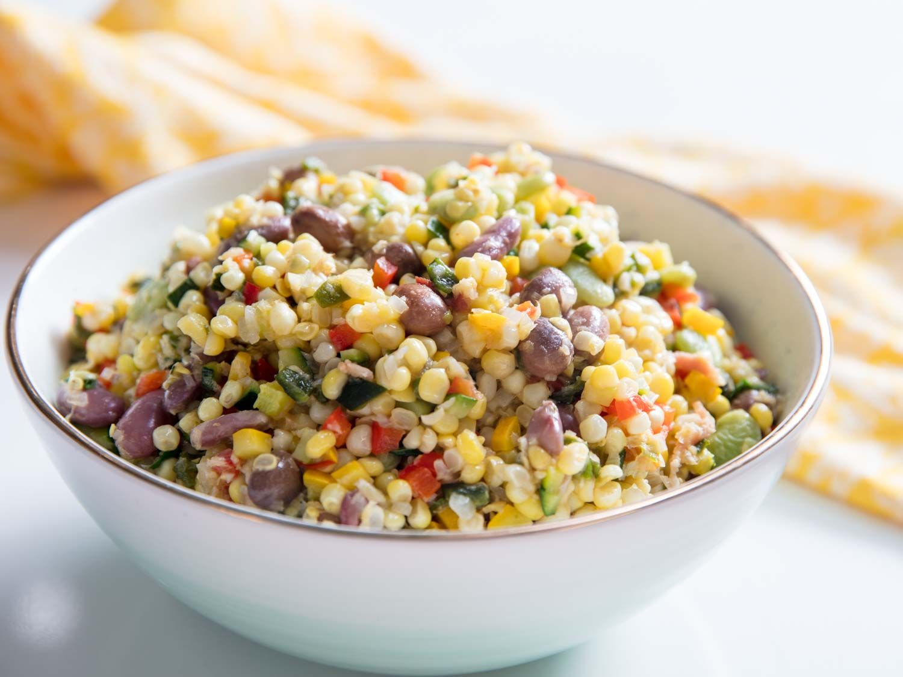

Corn, summer squash, bell pepper and beans cooked down in bacon fat and butter with charred poblanos, until a buttery glaze coats the vegetables.



Servings: `INPUT[inlineSelect(option(4), option(8), option(12), option(16), option(24)):servings_wanted]` (the source makes 8)

```dataviewjs
await dv.view("scripts/scale", {
  base: 8,
  ingredients: [
    { id: "poblano", name: "Poblano peppers", text: "6 ounces (170g; about 3 small or 2 medium)", q: 6, u: "ounces" },
    { id: "bacon", name: "Thinly sliced bacon", text: "1 ounce (30g)", q: 1, u: ["ounce", "ounces"] },
    { id: "butter", name: "Unsalted butter", text: "6 tablespoons (90g)", q: 6, u: ["tablespoon", "tablespoons"] },
    { id: "onion", name: "Medium onion, finely diced", text: "1 (about 6 ounces; 170g)", q: 1 },
    { id: "garlic", name: "Medium cloves garlic, minced", text: "2", q: 2 },
    { id: "corn", name: "Fresh corn in the husk, shucked, kernels cut and cobs scraped of any corn milk", text: "5 pounds (about 6 to 7 ears)", q: 5, u: "pounds" },
    { id: "bell", name: "Red (or orange or yellow) bell pepper, stemmed, seeded, finely diced", text: "One 6-ounce (170g)", q: 6, u: "ounces" },
    { id: "squash", name: "Summer squash, finely diced", text: "12 ounces (340g; about 4 small yellow squash and/or zucchini)", q: 12, u: "ounces" },
    { id: "beans", name: "Frozen and/or cooked fresh or dried beans, such as red kidney, cranberry or lima (see notes)", text: "2 cups (about 12 ounces; 340g)", q: 2, u: ["cup", "cups"] },
    { id: "beanwater", name: "Reserved bean-cooking water (plain water if using canned beans)", text: "½ cup (120ml)", q: 0.5, u: ["cup", "cups"] },
    { id: "saltpepper", name: "Kosher salt and freshly ground black pepper", text: "to taste", s: "to taste" },
    { id: "basil", name: "Fresh basil leaves, torn", text: "Small handful", q: 1, u: ["small handful", "small handfuls"] },
  ],
  steps: [
    "Using a broiler with the rack in the highest position, or working directly over a gas flame, char the poblano peppers ({poblano}), rotating them frequently, until the skin is blistered and black all over. Transfer to a heatproof bowl, cover with plastic, and let stand for 5 minutes. Rub the charred skin off with paper towels. Stem and seed the peppers, finely dice the flesh, and set aside.",
    "In a large Dutch oven, cook the bacon ({bacon}) over medium heat, stirring, until the fat has rendered and the bacon is beginning to brown, about 5 minutes. Add the butter ({butter}) and stir until melted. Add the onion ({onion}) and garlic ({garlic}) and cook, stirring, until they start to soften, about 3 minutes.",
    "Add the corn kernels ({corn}) and any corn milk you were able to express, along with the bell pepper ({bell}) and summer squash ({squash}). Cook, stirring, until the vegetables have become tender, about 10 minutes.",
    "Stir in the beans ({beans}) and the reserved bean liquid (or water) ({beanwater}), along with the reserved poblano. Season with salt and pepper. Keep cooking, stirring, until the succotash is heated through and a buttery glaze coats the vegetables, about 5 minutes.",
    "Add the basil leaves ({basil}), take it off the heat and serve. It can be refrigerated for up to 5 days, then rewarmed if you like, or served at room temperature.",
  ],
});
```

## Notes

- Special equipment: a Dutch oven.
- **Beans:** a mixture of at least two different types gives succotash a more interesting combination of textures, colors and flavors. The easiest approach is frozen beans, such as limas, or drained canned beans, added to the pot as they are. For the very best results, cook beans from scratch — drain them, add them to the pot, and reserve some of the cooking liquid for the recipe. Fresh shelling beans, sold at farmers markets in summer, follow the same method as dried beans but skip the presoak.

## Nutrition

Per serving, approximate (calculated automatically by the source site):

| Calories | Carbs | Protein | Fat  | Sat. fat | Fiber | Sugar | Sodium |
| -------- | ----- | ------- | ---- | -------- | ----- | ----- | ------ |
| 234 kcal | 28 g  | 8 g     | 12 g | 6 g      | 6 g   | 7 g   | 455 mg |
