# Recipe website data model

**Status:** Approved on 2026-11-14

Recipes, courses, tags and their parts are stored in the `recipes` schema of the Gambling App Supabase project (from 2026-11-13). The site reads them live with a read-only public key. Signed-in people (Supabase accounts shared with Workout and the Gambling App) also save their own favorites, Want to try marks and ratings.
The same tables were first shaped when recipes came from notes read at build time; the notes remain in the repo as an archive.

```mermaid
erDiagram
  COURSE |o--o{ RECIPE : "groups"
  RECIPE ||--o{ RECIPE_ALIAS : "also known as"
  RECIPE ||--o{ RECIPE_TAG : "tagged"
  TAG ||--o{ RECIPE_TAG : "applies to"
  RECIPE ||--o{ SERVING_OPTION : offers
  RECIPE ||--o{ RECIPE_INGREDIENT : lists
  RECIPE ||--o{ STEP : "has steps"
  RECIPE ||--o{ RECIPE_NOTE : "has notes"
  RECIPE ||--o{ NUTRIENT : "has nutrients"
  AUTH_USER ||--o{ WANT_TO_TRY : "marks"
  RECIPE ||--o{ WANT_TO_TRY : "marked by"
  AUTH_USER ||--o{ RATING : gives
  AUTH_USER ||--o{ FAVORITE : "favorites"
  RECIPE ||--o{ FAVORITE : "favorited by"
  RECIPE ||--o{ RATING : "rated by"
  RECIPE {
    uuid id PK
    uuid course_id FK "optional"
    string name "required, unique, the display name (the note's file name for imported recipes)"
    string slug "required, unique, the name in lowercase with hyphens, e.g. french-toast"
    string source_url "required"
    string archived_url
    string site
    string author
    string description
    string photo_path "path of the image file in the Storage bucket, e.g. French Toast.jpg; empty when none"
    date created "required"
    decimal base_amount "required, what the source makes"
    string amount_noun "required, servings or batches"
    string amount_noun_singular
    string servings_label "as written, the label before the servings dropdown, e.g. Servings, Makes, Pies"
    string prep_time "as written"
    string cook_time "as written"
    string total_time "as written"
    int total_minutes
    string nutrition_basis "as written, e.g. Per serving"
  }
  COURSE {
    uuid id PK
    string name "required, unique, e.g. Breakfast"
    int position "required, order of the chips"
  }
  RECIPE_ALIAS {
    uuid id PK
    uuid recipe_id FK "required"
    string alias "required"
  }
  TAG {
    uuid id PK
    string name "required, unique"
  }
  RECIPE_TAG {
    uuid recipe_id PK, FK
    uuid tag_id PK, FK
    int position "required, the order the recipe lists its tags"
  }
  SERVING_OPTION {
    uuid id PK
    uuid recipe_id FK "required"
    int position "required"
    decimal amount "required"
    string label "as written"
  }
  RECIPE_INGREDIENT {
    uuid id PK
    uuid recipe_id FK "required"
    int position "required"
    string ingredient_key "required, unique within a recipe"
    string name "required"
    string text_as_written "required"
    string group_name
    decimal quantity
    decimal quantity_high
    string unit_singular
    string unit_plural
    string fixed_text
    string lead_text
    decimal grams_before
    boolean hidden "required, default false"
  }
  STEP {
    uuid id PK
    uuid recipe_id FK "required"
    int position "required"
    string text "required, may contain ingredient keys in braces"
  }
  RECIPE_NOTE {
    uuid id PK
    uuid recipe_id FK "required"
    int position "required"
    int level "required, 0 for a note, 1 for a sub-note shown under the note before it"
    string text "required"
  }
  AUTH_USER {
    uuid id PK "Supabase's own account table (auth.users); not created by us"
  }
  WANT_TO_TRY {
    uuid user_id PK, FK "required"
    uuid recipe_id PK, FK "required"
    datetime added_at "required"
  }
  FAVORITE {
    uuid user_id PK, FK "required"
    uuid recipe_id PK, FK "required"
    datetime added_at "required"
  }
  RATING {
    uuid user_id PK, FK "required"
    uuid recipe_id PK, FK "required"
    decimal stars "required, 0.5 to 5 in steps of 0.5"
    datetime rated_at "required"
  }
  NUTRIENT {
    uuid id PK
    uuid recipe_id FK "required"
    int position "required"
    string name "required, e.g. Calories"
    string amount "required, as written, e.g. 81g"
  }
```

## Relationships
- A COURSE groups zero or more RECIPEs. A RECIPE has at most one COURSE (a recipe with none shows only under All).
- A RECIPE has zero or more RECIPE_ALIASes (the source's own title when it differs from the name). Each alias belongs to one recipe.
- A RECIPE is tagged with zero or more TAGs, and a TAG applies to zero or more RECIPEs, through RECIPE_TAG: one row per recipe and tag.
- A RECIPE offers zero or more SERVING_OPTIONs (the choices in the servings dropdown). Each belongs to one recipe.
- A RECIPE lists zero or more RECIPE_INGREDIENTs. Each belongs to one recipe.
- A RECIPE has zero or more STEPs. Each belongs to one recipe.
- A RECIPE has zero or more RECIPE_NOTEs (the author's notes, one per bullet). Each belongs to one recipe.
- A RECIPE has zero or more NUTRIENTs (one row per nutrient in the nutrition table). Each belongs to one recipe.
- An AUTH_USER (a Supabase account) marks zero or more RECIPEs as WANT_TO_TRY, and a RECIPE is marked by zero or more users: one row per user and recipe.
- An AUTH_USER gives zero or more RATINGs, and a RECIPE is rated by zero or more users: one row per user and recipe, so a person has at most one rating per recipe.
- An AUTH_USER favorites zero or more RECIPEs, and a RECIPE is favorited by zero or more users, through FAVORITE: one row per user and recipe.

## Rules
- A user can't have both a WANT_TO_TRY row and a RATING row for the same recipe: saving a RATING deletes that user's WANT_TO_TRY row for the recipe. Removing a RATING does not bring the WANT_TO_TRY row back.
- Deleting a RECIPE deletes its WANT_TO_TRY and RATING rows. Deleting a user deletes their WANT_TO_TRY and RATING rows.
- A person reads and writes only their own WANT_TO_TRY and RATING rows. Everyone, signed in or not, can read each recipe's average rating and rating count, but not who gave which rating.
- A FAVORITE is independent of WANT_TO_TRY and RATING: a person can favorite a recipe whether or not they have marked or rated it, and favoriting changes neither.
- Deleting a RECIPE deletes its FAVORITE rows. Deleting a user deletes their FAVORITE rows. A person reads and writes only their own FAVORITE rows; nobody else can see them.
- The average is the mean of all RATING `stars` for the recipe, shown to one decimal with the count; a recipe with no ratings has no average.
- COURSE values are a fixed list: Breakfast, Main, Side, Soup, Dessert, Sauce, in that order. Each note carries its course in a `course` property.
- Every list (serving options, ingredients, steps, notes, nutrients) is shown in `position` order, and a recipe's tags in their RECIPE_TAG `position` order.
- A RECIPE_NOTE with `level` 1 is a sub-note of the nearest earlier note with `level` 0 in `position` order, and is shown indented under it. The first note of a recipe is level 0.
- The six COURSE rows (Breakfast, Main, Side, Soup, Dessert, Sauce, positions 1 to 6) are created by the setup SQL, and the site's course chips are read from COURSE in `position` order.
- Times, nutrient amounts, the nutrition basis line and ingredient text are stored as the source writes them, with no conversions.
- `total_minutes` is the total time converted to whole minutes, and is empty when the source gives no total time.
- A recipe's photo is a file in the Storage bucket (public read), one per recipe, stored exactly as downloaded. `photo_path` is empty when the recipe has no photo or the upload failed. The address of the photo on the source site is not kept. Imported recipes keep their name-based file names from the old `images/` folder.
- A STEP's text can contain an ingredient's key in braces, like `{bread}`. The site replaces it with that ingredient's amount at the chosen servings.
- When an ingredient has a quantity, it is scaled by chosen servings / `base_amount`. When it has only fixed text, that text is shown at every size. A hidden ingredient is usable in steps but left out of the ingredients table.
- Nutrient values are per serving as written and do not change with the servings dropdown.
- The site always starts a recipe at `base_amount`.
- Deleting a RECIPE deletes its aliases, tag links, serving options, ingredients, steps, notes and nutrients, but not its TAGs. A TAG with no recipes is not shown.
- The public key can read every table in the `recipes` schema and the photo bucket, and cannot write. Only the Owner's service key writes.
- `slug` is the recipe `name` in lowercase with spaces and punctuation turned into hyphens, and is the recipe's address (`/recipe?name=<slug>`).
- Ingredient search matches RECIPE_INGREDIENT `name` for rows where `hidden` is false.
- Saving a recipe saves the RECIPE and all its aliases, tag links, serving options, ingredients, steps, notes and nutrients together, or none of them.
- Recipes are edited or deleted by the Owner in the Supabase dashboard.

## Changes
- 2026-11-13: RECIPE.`photo_url` is replaced by RECIPE.`photo_file` (stored image path).
- 2026-11-14: new COURSE and RECIPE.`course_id`. APP_USER and FAVORITE were drawn and then deferred with sign-in and favorites: each person has their own favorites, named by recipe name, deleted with their account (see todo.md).
- 2026-11-13: recipes are stored in Supabase (the `recipes` schema) instead of read from notes at build time. New RECIPE.`slug` (required, unique). RECIPE.`photo_file` (path in the repo) is replaced by RECIPE.`photo_path` (path in the Storage bucket). New rules: public read-only access, all-or-nothing save, ingredient search scope.
- 2026-11-13 (later): new RECIPE.`servings_label`, RECIPE_TAG.`position` and RECIPE_NOTE.`level`, so the database pages match the notes' pages (label, tag order, nested notes). The COURSE rows are seeded by the setup SQL.
- 2026-11-13: new WANT_TO_TRY and RATING (with AUTH_USER, Supabase's own accounts) for personal want-to-try marks and 0.5 to 5 star ratings. Blocked on sign-in (W-06). Back to Draft for approval.
- 2026-11-14: new FAVORITE table (user_id, recipe_id, added_at), tied to a recipe by its id now that recipes are in the database (it was drawn earlier as APP_USER and FAVORITE, named by recipe name, and deferred). AUTH_USER is Supabase's own account table, shared with Workout and the Gambling App, with open sign-up (W-06, W-14); no table of ours holds passwords or emails.
