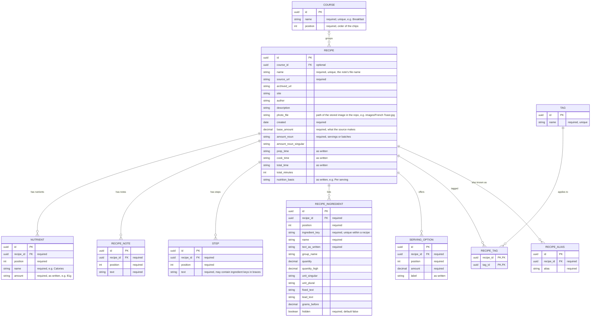

# Recipe website data model

**Status:** Approved on 2026-11-14

Recipes, courses, tags and their parts are read from the recipe notes at build time (nothing is stored for them).
They are shaped so the same tables can move into a database later, when recipes no longer come from GitHub.
The site saves nothing (accounts and favorites are deferred, see todo.md).

## Relationships
- A COURSE groups zero or more RECIPEs. A RECIPE has at most one COURSE (a recipe with none shows only under All).
- A RECIPE has zero or more RECIPE_ALIASes (the source's own title when it differs from the name). Each alias belongs to one recipe.
- A RECIPE is tagged with zero or more TAGs, and a TAG applies to zero or more RECIPEs, through RECIPE_TAG: one row per recipe and tag.
- A RECIPE offers zero or more SERVING_OPTIONs (the choices in the servings dropdown). Each belongs to one recipe.
- A RECIPE lists zero or more RECIPE_INGREDIENTs. Each belongs to one recipe.
- A RECIPE has zero or more STEPs. Each belongs to one recipe.
- A RECIPE has zero or more RECIPE_NOTEs (the author's notes, one per bullet). Each belongs to one recipe.
- A RECIPE has zero or more NUTRIENTs (one row per nutrient in the nutrition table). Each belongs to one recipe.

## Rules
- COURSE values are a fixed list: Breakfast, Main, Side, Soup, Dessert, Sauce, in that order. Each note carries its course in a `course` property.
- Every list (serving options, ingredients, steps, notes, nutrients) is shown in `position` order.
- Times, nutrient amounts, the nutrition basis line and ingredient text are stored as the source writes them, with no conversions.
- `total_minutes` is the total time converted to whole minutes, and is empty when the source gives no total time.
- A recipe's photo is a file in `images/` in the vault root, named after the recipe, stored exactly as downloaded. `photo_file` is empty when the recipe has no photo or the file is missing at build time. The address of the photo on the source site is not kept.
- A STEP's text can contain an ingredient's key in braces, like `{bread}`. The site replaces it with that ingredient's amount at the chosen servings.
- When an ingredient has a quantity, it is scaled by chosen servings / `base_amount`. When it has only fixed text, that text is shown at every size. A hidden ingredient is usable in steps but left out of the ingredients table.
- Nutrient values are per serving as written and do not change with the servings dropdown.
- The site always starts a recipe at `base_amount`.
- Deleting a RECIPE deletes its aliases, tag links, serving options, ingredients, steps, notes and nutrients, but not its TAGs. A TAG with no recipes is not shown.
- Until recipes move to a database, they come from the notes tagged `recipe` in the GitHub repo, one recipe per note.

## Changes
- 2026-11-13: RECIPE.`photo_url` is replaced by RECIPE.`photo_file` (stored image path).
- 2026-11-14: new COURSE and RECIPE.`course_id`. APP_USER and FAVORITE were drawn and then deferred with sign-in and favorites: each person has their own favorites, named by recipe name, deleted with their account (see todo.md).
